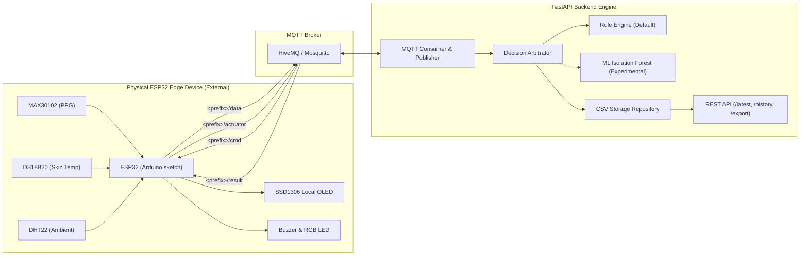

# IoT-Based Physiological Parameter Monitoring and Anomaly Detection

[](https://www.python.org/)
[](https://fastapi.tiangolo.com/)
[](https://mqtt.org/)

IoT-based physiological telemetry monitoring system providing multi-sensor acquisition (optical PPG Heart Rate, SpO2, and Skin Surface Temperature), real-time rule-based threshold evaluation, and experimental unsupervised anomaly detection.

---

## 1. Status

### What Works
- **Flat MQTT Ingestion**: Publishes and subscribes over `<prefix>/data`, `<prefix>/cmd`, `<prefix>/actuator`, and `<prefix>/result` with automatic reconnect and message validation (verified by `tests/test_pipeline.py` and `tests/test_telemetry_schema.py`).
- **Rule Engine Decision Arbitration**: Configurable physiological thresholds for normal, warning (severity 1), and critical (severity 2) states with rule fallback (verified by `tests/test_rules.py` and `tests/test_arbitrator.py`).
- **Experimental ML Inference**: Multivariate Isolation Forest evaluation with rolling windows ($W=15$) and persistence debouncing ($N=3$) (verified by `tests/test_ml_service.py`).
- **CSV Storage Repository**: Append-only storage with `(device_id, ts)` de-duplication across `readings.csv`, `predictions.csv`, `actuator_events.csv`, and `scenario_events.csv` (verified by `tests/test_csv_repo.py`).
- **Hardened REST API**: Fast, synchronous API with key-based authentication (`X-API-Key`) protecting write/export endpoints and disabled default credentials (verified by `tests/test_api.py`).
- **Dataset Tools**: Interactive multi-scenario simulator (`scripts/simulate_device.py`), scenario tagging CLI (`scripts/tag_scenario.py`), and dataset integrity checker (`scripts/dataset_check.py`, verified by `tests/test_dataset_check.py`).

### What Is Not Included in This Repository
- **Firmware**: The microcontroller code is an external Arduino sketch running on the physical ESP32 device and is **not** included in this repository.
- **Frontend**: The visualization dashboard lives in a separate frontend repository/project and is **not** included in this repository.
- **Raw Training Datasets**: Public datasets are downloaded directly from Kaggle and are not tracked in git.
- **Trained Model Artifacts**: Trained `.joblib` model binaries and scalers are generated via `ml_pipeline/` and are not committed to git (`ml_pipeline/models/` contains `.gitkeep` only).

### Evaluation Claims
No evaluation performance results or clinical diagnostic claims are asserted for this repository. Empirical behavior on physical hardware sessions must be established during live data collection under the protocol described in [`docs/EVALUATION_PROTOCOL.md`](docs/EVALUATION_PROTOCOL.md). Known distribution mismatches in the public training sets are documented in [`docs/KNOWN_LIMITATIONS.md`](docs/KNOWN_LIMITATIONS.md).

---

## 2. System Architecture



---

## 3. Reference Wiring of the Firmware Used on the Device (Firmware Not Included)

The following pinout represents the physical hardware wiring used with the device's Arduino sketch:

| Component | Function / Measurement | Edge Interface | ESP32 Pinout |
| :--- | :--- | :---: | :---: |
| **MAX30102** | Optical Photoplethysmogram (Heart Rate, SpO2) | I2C | GPIO 21 (SDA), GPIO 22 (SCL) |
| **DS18B20** | Digital Skin Surface Temperature | 1-Wire | GPIO 4 (with 4.7kΩ pull-up) |
| **SSD1306 OLED** | 0.96-inch Monochrome Display (0x3C) | I2C | GPIO 16 (SDA), GPIO 17 (SCL) |
| **DHT22 / AM2302** | Ambient Room Temperature and Humidity | Digital Input | GPIO 14 |
| **Active Buzzer** | Acoustic Alarm for Critical Alerts | Digital Output | GPIO 25 (active-low) |
| **RGB LED** | Visual Actuation Indicator | Digital Output | GPIO 26 (Red), GPIO 27 (Green), GPIO 32 (Blue) |

> [!NOTE]
> The Arduino sketch running on the physical ESP32 is managed separately and is not part of this repository.

---

## 4. Flat MQTT Protocol Contract

Communication uses four flat MQTT topics partitioned by `TOPIC_PREFIX`:

| Topic Direction | MQTT Topic | Payload Schema & Key Fields |
| :--- | :--- | :--- |
| **Edge &rarr; Server** | `<prefix>/data` | `{"device_id": "esp32-01", "hr": 75.0, "spo2": 98.0, "temp": 33.2, "hum": 60.0, "room_temp": 28.5, "finger": true, "status": "NORMAL"}` |
| **Server &rarr; Edge** | `<prefix>/result` | `{"label": "NORMAL", "severity": 0, "score": 0.1957, "model_version": "if_v1"}` |
| **Server &rarr; Edge** | `<prefix>/cmd` | `{"mode": "AUTO", "color": "RED", "brightness": 100, "buzzer_test": true, "seq": 42}` |
| **Edge &rarr; Server** | `<prefix>/actuator` | `{"mode": "AUTO", "led": {"color": "RED", "brightness": 100}, "buzzer": {"test": true}, "source": "ML_RESULT", "ack_seq": 42, "manual_left_s": 0}` |

*Severity convention*: `0` = Normal, `1` = Warning / Borderline, `2` = Critical Alert.

---

## 5. Local CSV Storage Architecture

The backend persists telemetry and events into structured CSV files inside `CSV_DIR` (default `./data`):

1. **`readings.csv`**: Raw sensor telemetry de-duplicated on `(device_id, ts)`:
   `ts, device_id, hr, spo2, temp, hum, room_temp, finger, fw_status`
2. **`predictions.csv`**: Evaluated severity outputs and scoring breakdown:
   `ts, device_id, rule_severity, ml_severity, published_severity, decision_mode, decision_source`
3. **`actuator_events.csv`**: Sequence-tracked commands and status acknowledgments:
   `ts, kind, seq, payload_json`
4. **`scenario_events.csv`**: Operational activity tags:
   `ts, scenario, note`

---

## 6. REST API Endpoints

Synchronous endpoints generated by the FastAPI application:

### Health Checks (No Auth Required)
- `GET /health`: Liveness probe (`{"status": "ok"}`).
- `GET /health/details`: Readiness probe reporting MQTT connectivity, CSV directory availability, and ML model loaded status.

### Telemetry & Device State
- `GET /latest?device_id=esp32-01`: Most recent valid reading and latest actuator event.
- `GET /history?minutes=30&device_id=esp32-01`: Historical readings within the specified time window (`minutes` between 1 and 1440, default 30).
- `GET /predictions?limit=100&device_id=esp32-01`: Recent prediction records (`limit` between 1 and 1000, default 100).
- `GET /device/status?device_id=esp32-01`: Online status based on recent reading age (`{"online": true, "age_s": 1.2}`).

### Actuator Control
- `GET /actuator/status`: Current actuator state and acknowledged sequence.
- `POST /actuator/mode`: Switch mode. Header: `X-API-Key`. Body: `{"mode": "AUTO"}` or `{"mode": "MANUAL"}`.
- `POST /actuator/led`: Override LED. Header: `X-API-Key`. Body: `{"color": "GREEN", "brightness": 50}` (`color` enum: `OFF`, `GREEN`, `RED`, `BLUE`, `YELLOW`, `WHITE`; `brightness`: 0–100).
- `POST /actuator/buzzer`: Trigger acoustic test. Header: `X-API-Key`. Body: `{"test": true}`.

### Scenario Tagging
- `POST /session/scenario`: Tag active activity session. Header: `X-API-Key`. Body: `{"scenario": "REST", "note": "baseline resting"}` (`scenario` enum: `REST`, `TYPING`, `LIGHT_ACTIVITY`, `MOTION`, `FINGER_SHIFT`, `SENSOR_OFF`, `OTHER`).
- `GET /session/scenario`: Active session scenario tag.

### Dataset Export
- `GET /export/readings.csv`: Stream raw `readings.csv`. Header: `X-API-Key`.
- `GET /export/dataset.csv`: Stream joined dataset combining sensor vitals, predictions, active scenario tag, and actuator states via an exact **as-of join**. Header: `X-API-Key`.

---

## 7. Decision Arbitration: Rule Engine vs. ML

- **Rule Engine (`DECISION_MODE=RULE` - Default)**: Configurable physiological thresholds via `.env`:
  - Critical Alert (Severity 2): `HR < 50` or `HR > 100` BPM; `SpO2 < 90%`; `Temp >= 38.0°C` (optional).
  - Warning Band (Severity 1): `50 <= HR < 55` or `95 < HR <= 100` BPM; `90 <= SpO2 <= 94%`.
  - Low-temperature alert rules disabled by default.
- **Machine Learning (`DECISION_MODE=ML` - Experimental)**: Isolation Forest with rolling feature windows ($W=15$ post-warmup samples) and persistence debouncing ($N=3$). Automatic fallback to Rule Engine (`decision_source=RULE_FALLBACK`) during warm-up or if model files are absent. Detailed limitations documented in [`docs/KNOWN_LIMITATIONS.md`](docs/KNOWN_LIMITATIONS.md).

---

## 8. Python Version and Quickstart

### Python Runtime
Tested on **Python 3.12**. No `pyproject.toml` or CI runner is configured in the repository.

### Quickstart Setup
```bash
# 1. Clone repository
git clone https://github.com/Rnvz/IoT-based-Physiological-Parameter-Monitoring-and-Anomaly-Detection.git
cd IoT-based-Physiological-Parameter-Monitoring-and-Anomaly-Detection

# 2. Create virtual environment and install backend dependencies
python3 -m venv .venv
source .venv/bin/activate
pip install -r backend/requirements.txt

# 3. Configure environment
cp backend/.env.example backend/.env
# Set TOPIC_PREFIX to your unique MQTT prefix and configure API_KEY

# 4. Run automated test suite
pytest tests/ -v

# 5. Start backend service
PYTHONPATH=backend uvicorn app.main:app --host 0.0.0.0 --port 8000
```
Verify server liveness in another terminal:
```bash
curl http://localhost:8000/health
# Output: {"status":"ok"}
```

### Dependency Notes
- `backend/requirements.txt` contains all runtime dependencies (`fastapi`, `uvicorn[standard]`, `paho-mqtt`, `pydantic`, `pydantic-settings`, `python-dotenv`, `sqlalchemy`, `aiosqlite`), core ML runtime packages (`scikit-learn`, `pandas`, `numpy`, `scipy`, `joblib`), and test tools (`httpx`, `pytest`, `pytest-mock`).
- Offline exploratory training notebooks under `ml_pipeline/` require additional plotting and notebook packages (`matplotlib`, `seaborn`, `jupyter`, `openpyxl`) specified in `ml_pipeline/requirements.txt`.

---

## 9. Simulator and Dataset Isolation

Simulated data must never contaminate physical device data. Run the simulator against an isolated prefix and directory:

```bash
# 1. Start backend with isolated storage
CSV_DIR=./data_sim TOPIC_PREFIX=physiomonitor/test PYTHONPATH=backend uvicorn app.main:app --host 0.0.0.0 --port 8000

# 2. Run interactive simulator (1 Hz live terminal table)
python scripts/simulate_device.py --topic-prefix physiomonitor/test

# 3. Or run fast 1,200-sample pipeline benchmark
python scripts/simulate_device.py --topic-prefix physiomonitor/test --fast-1200
```

---

## 10. Own-Device Recording and Dataset Validation

During physical recording sessions:
1. **Tag Active Activity Scenarios**:
   ```bash
   python scripts/tag_scenario.py REST --note "posisi duduk relaks"
   python scripts/tag_scenario.py TYPING --note "mengetik naskah skripsi"
   python scripts/tag_scenario.py MOTION --note "berjalan santai di ruangan"
   python scripts/tag_scenario.py --show
   ```
2. **Verify Dataset Integrity**:
   Check timestamps, duplicate records, high-frequency bursts, and progress toward the 1,000 valid-row target:
   ```bash
   python scripts/dataset_check.py -i data/readings.csv
   ```

---

## 11. Credits

- **Firmware**: `<author/source>`
- **Dashboard**: `<source>`
- **AI-assisted development**: `<tool names and scope - to be filled by the author as required by the course policy>`
- **Datasets**:
  - *Human Vital Signs Dataset*: [https://www.kaggle.com/datasets/engrarri21/human-vital-signs](https://www.kaggle.com/datasets/engrarri21/human-vital-signs)
  - *Human Vital Sign Dataset*: [https://www.kaggle.com/datasets/nasirayub2/human-vital-sign-dataset](https://www.kaggle.com/datasets/nasirayub2/human-vital-sign-dataset)
  - *Synthetic Patient HealthCare Monitoring Dataset*: `UNVERIFIED` (source URL and origin not independently verified in repository data).
