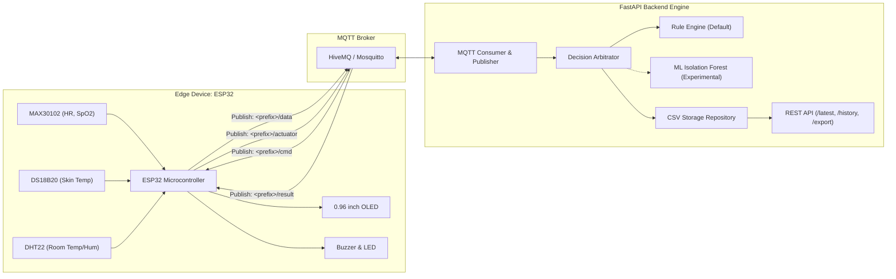

# IoT-Based Physiological Parameter Monitoring and Anomaly Detection

[](https://www.python.org/)
[](https://fastapi.tiangolo.com/)
[](https://mqtt.org/)
[](https://platformio.org/)
[]()

IoT-based physiological telemetry monitoring system providing multi-sensor acquisition (optical PPG Heart Rate, SpO2, and Skin Surface Temperature), real-time rule-based threshold evaluation, and experimental unsupervised anomaly detection.

---

## 1. System Overview

This system acquires physiological parameters from an ESP32 edge microcontroller and transmits them via MQTT to a FastAPI backend service. The server processes telemetry, executes decision arbitration (Rule-Based vs. Machine Learning), logs records to a de-duplicated CSV repository, and exposes a hardened REST API for dashboards and data export.



---

## 2. Hardware Specifications

| Component | Function / Measurement | Edge Interface | ESP32 Pinout |
| :--- | :--- | :---: | :---: |
| **ESP32 NodeMCU** | Central 32-bit Dual-Core Edge Controller | Core | - |
| **MAX30102** | Optical Photoplethysmogram (Heart Rate, SpO2) | I2C | GPIO 21 (SDA), GPIO 22 (SCL) |
| **DS18B20** | Digital Skin Surface Temperature | 1-Wire | GPIO 4 (with 4.7kΩ pull-up) |
| **DHT22 / AM2302** | Ambient Room Temperature and Humidity | Digital | GPIO 19 |
| **SSD1306 OLED** | 0.96-inch Monochrome Local Display (0x3C) | I2C | GPIO 21 (SDA), GPIO 22 (SCL) |
| **Active Buzzer** | Acoustic Alert for Critical Alarms | Digital Output | GPIO 25 |
| **Status LED** | Visual Actuation Indicator (RGB) | Digital Output | GPIO 26 / 27 |

---

## 3. Flat MQTT Protocol Contract

Communication between the edge node and backend uses four flat MQTT topics partitioned by a configurable `TOPIC_PREFIX`:

| Topic Direction | MQTT Topic | Payload Schema & Key Fields |
| :--- | :--- | :--- |
| **Edge &rarr; Server** | `<prefix>/data` | `{"device_id": "esp32-01", "hr": 75.0, "spo2": 98.0, "temp": 33.2, "hum": 60.0, "room_temp": 28.5, "finger": true, "status": "NORMAL"}` |
| **Server &rarr; Edge** | `<prefix>/result` | `{"label": "NORMAL", "severity": 0, "score": 0.1957, "model_version": "if_v1"}` |
| **Server &rarr; Edge** | `<prefix>/cmd` | `{"mode": "AUTO", "color": "RED", "brightness": 100, "buzzer_test": true, "seq": 42}` |
| **Edge &rarr; Server** | `<prefix>/actuator` | `{"mode": "AUTO", "led": {"color": "RED", "brightness": 100}, "buzzer": {"test": true}, "source": "ML_RESULT", "ack_seq": 42, "manual_left_s": 0}` |

*Severity convention*: `0` = Normal, `1` = Warning / Borderline, `2` = Critical Alert.

---

## 4. Local CSV Storage Architecture

The backend persists telemetry and system events to structured CSV files within a configurable storage directory (`CSV_DIR`, default `./data`):

1. **`readings.csv`**: Raw sensor telemetry de-duplicated on `(device_id, ts)`:
   `ts, device_id, hr, spo2, temp, hum, room_temp, finger, fw_status`
2. **`predictions.csv`**: Evaluated severity outputs and scoring breakdown:
   `ts, device_id, rule_severity, ml_severity, published_severity, decision_mode, decision_source`
3. **`actuator_events.csv`**: Sequence-tracked commands and status acknowledgments:
   `ts, kind, seq, payload_json`
4. **`scenario_events.csv`**: Benign operational tags for evaluation recordings:
   `ts, scenario, note`

---

## 5. REST API Endpoints

The FastAPI service exposes synchronous endpoints for dashboards and data verification (default base URL: `http://localhost:8000`):

- **Health Checks**:
  - `GET /health`: Liveness probe (`{"status": "ok"}`).
  - `GET /health/details`: Readiness probe checking MQTT connection, storage availability, and ML model status.
- **Telemetry & State**:
  - `GET /latest`: Latest valid telemetry reading and actuator status.
  - `GET /history?limit=100`: Recent telemetry series for charting.
  - `GET /predictions?limit=100`: Recent decision arbitration records.
  - `GET /device/status`: Current connection state and latency statistics.
- **Actuator Control**:
  - `GET /actuator/status`: Current actuator state.
  - `POST /actuator/mode`: Switch mode (`AUTO` vs `MANUAL`).
  - `POST /actuator/led`: Manual LED override (`color`, `brightness`).
  - `POST /actuator/buzzer`: Manual acoustic test (`duration_ms`).
- **Scenario Tagging**:
  - `POST /session/scenario`: Tag current session (`REST`, `TYPING`, `LIGHT_ACTIVITY`, `MOTION`, `FINGER_SHIFT`, `SENSOR_OFF`, `OTHER`).
  - `GET /session/scenario`: Fetch currently active scenario tag.
- **Dataset Export**:
  - `GET /export/readings.csv`: Stream raw `readings.csv`.
  - `GET /export/dataset.csv`: Stream complete research dataset combining vitals, predictions, scenario tags, and actuator states via an exact **as-of join**.

*Security*: Write and export endpoints require an `X-API-Key` header. Read endpoints can optionally enforce authentication via `READ_AUTH_REQUIRED=true`.

---

## 6. Decision Arbitration: Rule Engine vs. ML

The backend calculates both `rule_severity` and `ml_severity` on every valid message where `finger=True`. The published severity is selected by `DECISION_MODE`:

### Rule Engine (`DECISION_MODE=RULE` - Default)
Rule mode is the **default operational mode**. Thresholds are fully configurable via `.env` without hardcoding:
- Critical Alert (Severity 2): `HR < 50` or `HR > 100` BPM; `SpO2 < 90%`; `Temp >= 38.0°C` (optional).
- Warning Band (Severity 1): `50 <= HR < 55` or `95 < HR <= 100` BPM; `90 <= SpO2 <= 94%`.
- Low-temperature rules are disabled by default.

### Machine Learning (`DECISION_MODE=ML` - Experimental)
> [!WARNING]
> **Experimental ML Mode**: Multivariate anomaly detection uses an Isolation Forest model with per-device rolling windows ($W=15$ samples) and persistence debouncing ($N=3$).
> The ML model is designated as **experimental** due to verified dataset distribution mismatches in public training data. Consult [`docs/KNOWN_LIMITATIONS.md`](docs/KNOWN_LIMITATIONS.md) for full empirical diagnostic reports.
> If the ML result is unavailable or during the initial 15-sample warm-up, the system automatically falls back to Rule Mode (`decision_source=RULE_FALLBACK`).

---

## 7. Quickstart Guide

### 1. Environment Setup
```bash
git clone https://github.com/Rnvz/IoT-based-Physiological-Parameter-Monitoring-and-Anomaly-Detection.git
cd IoT-based-Physiological-Parameter-Monitoring-and-Anomaly-Detection

# Create virtual environment and install backend dependencies
python3 -m venv .venv
source .venv/bin/activate
pip install -r backend/requirements.txt
```

### 2. Configure Environment Variables
```bash
cp backend/.env.example backend/.env
# Edit backend/.env with your MQTT broker, topic prefix, and secret API key
```

### 3. Run Backend Service
```bash
cd backend
uvicorn app.main:app --host 0.0.0.0 --port 8000 --reload
```
Interactive OpenAPI documentation will be available at `http://localhost:8000/docs`.

### 4. Run Automated Test Suite
```bash
# Execute from project root
pytest tests/ -v
```

---

## 8. Simulator and Dataset Isolation

Simulated telemetry must **never** contaminate real device recordings. Always run the simulator against a dedicated test prefix and separate storage directory.

```bash
# 1. Start backend with isolated storage
CSV_DIR=./data_sim TOPIC_PREFIX=physiomonitor/test uvicorn app.main:app --host 0.0.0.0 --port 8000

# 2. Run interactive 5-scenario simulator (1 Hz live table)
python scripts/simulate_device.py --topic-prefix physiomonitor/test

# 3. Or run fast 1,200-sample pipeline benchmark
python scripts/simulate_device.py --topic-prefix physiomonitor/test --fast-1200
```

---

## 9. Own-Device Recording and Dataset Validation

When recording sessions from the physical ESP32 device:

1. **Tag Active Activity Scenarios**:
   ```bash
   python scripts/tag_scenario.py REST --note "kamar tidur, posisi duduk relaks"
   python scripts/tag_scenario.py TYPING --note "mengetik naskah skripsi"
   python scripts/tag_scenario.py MOTION --note "berjalan santai di ruangan"

   # View active tag
   python scripts/tag_scenario.py --show
   ```

2. **Verify Dataset Quality and Integrity**:
   Check timestamp continuity, duplicate records, high-frequency bursts, and progress toward the 1,000 valid-row target:
   ```bash
   python scripts/dataset_check.py -i data/readings.csv
   ```

---

## 10. Dashboard Web UI Note

The end-user visualization dashboard resides in `frontend/` (consuming the `/latest`, `/history`, and `/predictions` REST endpoints). 
Please note that `frontend/` is decoupled from this core ingestion and analysis engine and is **not** currently part of this repository branch.

---

## 11. Project Credits and Contributors

- **Yohanes Wenanta** ([@Rnvz](https://github.com/Rnvz)): Embedded firmware development (PlatformIO/C++), hardware sensor interfacing (MAX30102, DS18B20, SSD1306), and initial pipeline architecture.
- **Cona / Advanced Agentic Coding Pair Programmer**: Modular backend rebuild (FastAPI), flat MQTT contract implementation, configurable rule engine, ML adapter with per-device rolling windows, REST API security hardening, dataset integrity checking tools, and empirical diagnostic documentation.
- **Dataset Authors**:
  - Nasir Ayub et al. (*Human Vital Signs Dataset 2024*)
  - Engr Arri (*Human Vital Signs R Dataset*)
  - Gourango Mandal (*Synthetic Patient HealthCare Monitoring Dataset*)
