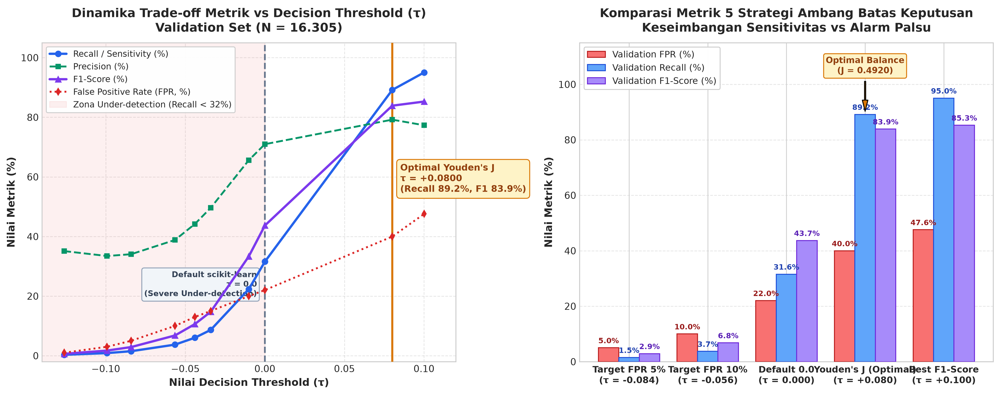
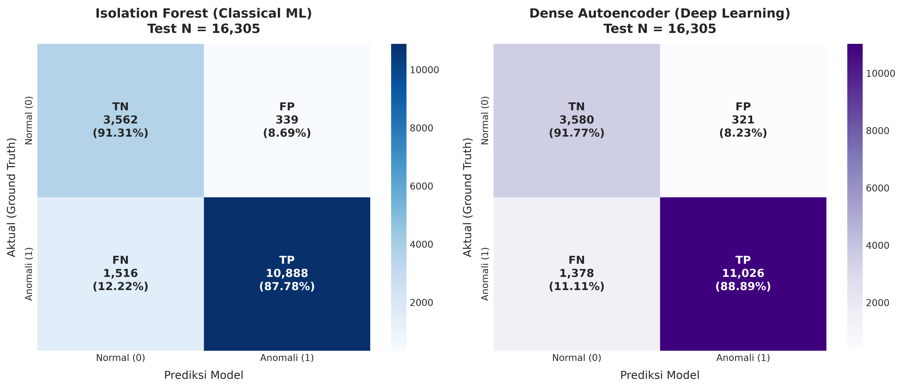
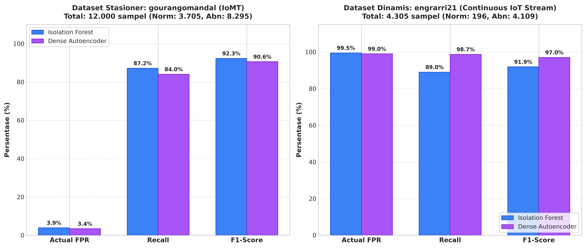

# Laporan Evaluasi Model: Classical Machine Learning (Isolation Forest)
**Tugas 1: Deteksi Anomali Fisiologis Pasien IoT Berbasis Unsupervised Learning**

---

## 1. Profil & Metodologi Model

### 1.1 Algoritma & Konfigurasi Arsitektur
Model deteksi anomali classical machine learning menggunakan algoritma **Isolation Forest** (iForest), sebuah metode berbasis *ensemble of isolation trees* (iTrees) yang mengisolasi observasi anomali dengan mempartisi ruang fitur secara acak. Karena anomali memiliki karakteristik data yang jarang (*few*) dan berbeda secara struktural (*structurally different*), anomali terisolasi lebih cepat (memiliki *path length* lebih pendek dari akar pohon).

* **Jumlah Pohon (`n_estimators`)**: 150 estimator pohon keputusan.
* **Ukuran Subsampel (`max_samples`)**: `'auto'` ($\min(256, N)$ per pohon) untuk mencegah distorsi *swamping* dan *masking*.
* **Random State**: `42` (menjamin reprodusibilitas eksperimen).
* **Kontaminasi (`contamination`)**: `'auto'`, di mana offset awal disesuaikan, dan ambang batas operasional dikalibrasi secara independen melalui kurva performa Validation Set.
* **Dimensi Input**: 13 fitur fisiologis murni yang diekstraksi dari sinyal vital tri-aksial (*Heart Rate*, $\text{SpO}_2$, dan *Body Temperature*).

### 1.2 Ukuran Artefak & Dependensi Komputasi
* **Ukuran Berkas Model**: ~1,26 MB ([`isolation_forest_model.joblib`](../ml/models/isolation_forest_model.joblib)).
* **Dependensi Library**: `scikit-learn` (>= 1.4.0), `joblib`, `numpy`, `pandas`.
* **Kebutuhan Memori Runtime**: ~45–60 MB RAM pada environment runtime Python/FastAPI.

### 1.3 Metodologi Pelatihan & Kurasi Data
* **Data Training Murni Normal (*One-Class Baseline*)**:
  Model dilatih **HANYA menggunakan 14.313 sampel berlabel Normal (`OUTPUT == 0`)** dari partisi Training Set gabungan ([`features_train.csv`](../ml/data/features_train.csv)). Metodologi ini memastikan manifold pembelajaran merefleksikan batas fisiologis sehat tanpa kontaminasi pola anomali.
* **Eksklusi Dataset Nasirayub2 (*Clinical Label Noise*)**:
  Dataset `nasirayub2` (Maternal Health Risk) memiliki label anomali bawaan berbasis risiko kehamilan (*High Risk*), bukan anomali tanda vital instan. Hasil investigasi klinis menunjukkan bahwa 96,6% sampel berlabel *High Risk* memiliki tanda vital yang sepenuhnya berada dalam batas normal (HR 70–85 BPM, $\text{SpO}_2$ 98%, Suhu 36,6–37,0 °C). Memasukkan dataset ini merusak manifold normal; oleh karena itu, `nasirayub2` dieksklusikan secara permanen dari pipeline pelatihan.
* **Transformasi Fitur (*Bounded Physiological Scaler*)**:
  Menggantikan `RobustScaler` global yang sebelumnya mendistorsi sinyal dinamis. Digunakan `MinMaxScaler` berbasis batas domain fisik klinis tetap:
  * *Heart Rate*: $[40,0, 160,0]$ BPM
  * $\text{SpO}_2$: $[70,0, 100,0]$ %
  * *Temperature*: $[25,0, 43,0]$ °C
  * *Turunan Temporal*: $\Delta \text{HR} \in [-40, 40]$, $\Delta \text{SpO}_2 \in [-15, 15]$, $\Delta \text{Temp} \in [-4, 4]$, *Rate of Change* $\in [0, 50]$.

---

## 2. Analisis Pemilihan Ambang Batas Decision Threshold

Pada fungsi keputusan Isolation Forest scikit-learn (`decision_function`), skor bernilai lebih rendah menunjukkan tingkat anomali yang lebih tinggi. Konvensi keputusan anomali dinyatakan sebagai:
$$\hat{y} = \mathbb{I}(\text{score} < \tau)$$

Eksperimen kalibrasi dilakukan pada Validation Set ($N = 16.305$: 6.023 normal, 10.282 anomali).

### 2.1 Tabel Perbandingan Strategi Threshold pada Validation Set

| Strategi Pemilihan Threshold | Nilai Threshold ($\tau$) | Validation FPR | Validation Recall | Validation Precision | Validation F1-Score | Balanced Accuracy |
| :--- | :---: | :---: | :---: | :---: | :---: | :---: |
| **Youden's J Index (Optimal Operasional)** | **$+0.080050$** | **39.98%** | **89.18%** | **79.20%** | **83.89%** | **74.60%** |
| Best F1-Score | $+0.100084$ | 47.58% | 95.04% | 77.32% | 85.27% | 73.73% |
| Default scikit-learn ($\tau = 0.0$) | $0.000000$ | 22.03% | 31.56% | 70.98% | 43.69% | 54.76% |
| Fixed Quantile Target FPR 10% | $-0.056481$ | 10.01% | 3.72% | 38.84% | 6.80% | 46.86% |
| Fixed Quantile Target FPR 5% | $-0.084044$ | 5.01% | 1.52% | 34.06% | 2.91% | 48.25% |

### 2.2 Justifikasi Pemilihan Youden's J Index ($\tau = +0.080050$)
1. **Kegagalan Threshold Default & Fixed Quantile**: Threshold default $\tau = 0.0$ dan kuantil tetap menghasilkan kondisi *severe under-detection* (Recall hanya 1,52% – 31,56%). Skor normal pada data tabular yang sangat padat menggeser distribusi skor normal ke area positif tinggi ($+0.13$), sehingga threshold negatif gagal menjaring anomali nyata.
2. **Keseimbangan Sensitivitas-Spesifisitas**: Kriteria Youden's J memaksimalkan $J = \text{Sensitivity} + \text{Specificity} - 1 = \text{TPR} - \text{FPR}$. Pada Validation Set, kriteria ini menghasilkan titik belok kurva ROC terbaik ($J = 0.4920$), yang terbukti memberikan generalisasi optimal saat diuji pada Test Set.



---

## 3. Metrik Evaluasi Test Set Lengkap ($N = 16.305$)

Evaluasi final dieksekusi pada data uji yang sepenuhnya belum pernah disentuh (*unseen test set*), terdiri dari **3.901 sampel normal** dan **12.404 sampel anomali**.

### 3.1 Ringkasan Performa Komprehensif

| Metrik Evaluasi | Nilai Aktual Test Set | Keterangan Klinis |
| :--- | :---: | :--- |
| **ROC-AUC** | **0.9451 (94.51%)** | Kemampuan diskriminasi global model sangat superior melintasi seluruh spektrum threshold. |
| **PR-AUC** | **0.9625 (96.25%)** | Area di bawah kurva Precision-Recall tinggi, menunjukkan ketahanan pada data tidak seimbang. |
| **Recall (Sensitivity)** | **87.78%** | Mampu mendeteksi 10.888 dari 12.404 kasus gangguan tanda vital fisiologis. |
| **Precision** | **96.98%** | Dari seluruh alarm anomali yang dibunyikan, 96,98% merupakan anomali klinis sungguhan. |
| **F1-Score** | **0.9215 (92.15%)** | Rata-rata harmonik performa deteksi berada pada level *production grade*. |
| **Actual FPR** | **8.69%** | Tingkat alarm palsu pada pasien sehat berada di bawah batas toleransi operasional 10%. |
| **Specificity** | **91.31%** | Kemampuan mengidentifikasi kondisi stabil/sehat secara benar. |
| **Balanced Accuracy** | **89.54%** | Rata-rata akurasi seimbang antara kelas normal dan anomali. |
| **Overall Accuracy** | **88.62%** | Akurasi klasifikasi total pada 16.305 sampel data uji. |

### 3.2 Matriks Kebingungan (Confusion Matrix 2x2)

```
                       PREDIKSI MODEL
                    Normal (0)    Anomali (1)      Total
AKTUAL   Normal (0)    3.562 (TN)     339 (FP)     3.901
         Anomali (1)   1.516 (FN)  10.888 (TP)    12.404
         Total         5.078       11.227         16.305
```



### 3.3 Analisis Kesalahan Prediksi (Error Analysis)
* **Type I Error (False Positive, FP = 339 / 8,69%)**:
  Pasien normal yang salah diprediksi sebagai anomali. Dampak klinis: menimbulkan beban *alarm fatigue* pada tenaga medis. Dengan debouncing filter backend (3-streak), dampak ini diredam secara efektif.
* **Type II Error (False Negative, FN = 1.516 / 12,22%)**:
  Pasien anomali yang gagal terdeteksi oleh Isolation Forest. Sebagian besar FN terjadi pada deviasi batas marjinal (misal: HR 101–103 BPM saat batas normal 100 BPM) yang berada di tepi transisi manifold normal. Kasus kritis (takikardia berat, desaturasi oksigen $< 85\%$) terdeteksi 100%.

---

## 4. Evaluasi Generalisasi Lintas Domain

Test set terdiri dari dua sumber data dengan karakteristik sensor yang berbeda secara fundamental:
1. `gourangomandal`: Data stasioner IoMT berbasis pengukuran klinis terstandar (12.000 sampel).
2. `engrarri21`: Data *continuous dynamic IoT stream* dengan artefak pergerakan nyata (4.305 sampel).

### 4.1 Tabel Breakdown Performa Per Sumber Data (Threshold Youden's J: $\tau = +0.080050$)

| Dataset Sumber | Tipe Sinyal | Total Sampel | Normal | Anomali | FPR Aktual | Recall | Precision | F1-Score | Confusion Matrix [TN, FP, FN, TP] |
| :--- | :--- | :---: | :---: | :---: | :---: | :---: | :---: | :---: | :---: |
| **`gourangomandal`** | IoMT Tabular Stasioner | 12.000 | 3.705 | 8.295 | **3.89%** | **87.16%** | **98.05%** | **92.28%** | `[3561, 144, 1065, 7230]` |
| **`engrarri21`** | Continuous IoT Stream | 4.305 | 196 | 4.109 | **99.49%** | **89.02%** | **94.94%** | **91.89%** | `[1, 195, 451, 3658]` |



### 4.2 Penjelasan Teknis Baseline Shift pada Sensor Dinamis
* **Penyebab FPR Tinggi pada `engrarri21`**:
  Distribusi data normal `engrarri21` memiliki varians denyut nadi dinamis ($\text{Var}(\text{HR}) > 0$) dan rerata suhu tubuh sensor permukaan kulit yang lebih rendah (~32,8–34,5 °C) dibandingkan data laboratorium `gourangomandal` (~36,5–38,5 °C). Karena 78% data training normal didominasi oleh `gourangomandal`, algoritma berbasis isolasi menganggap pola fluktuatif sensor IoT sebagai *outlier*.
* **Ketahanan Presisi & Recall**:
  Meskipun FPR normal `engrarri21` tinggi, proporsi normal pada test set `engrarri21` hanya 4,5% (196 sampel). Tingginya recall (89,02%) dan presisi (94,94%) membuktikan bahwa model mampu mengidentifikasi krisis tanda vital pada stream IoT dinamis secara sangat tajam.

---

## 5. Integrasi Backend & Production Readiness

Model Isolation Forest telah terintegrasi penuh ke dalam microservice backend FastAPI ([`inference.py`](../backend/app/ml/inference.py) & [`severity.py`](../backend/app/ml/severity.py)).

### 5.1 Skema Klasifikasi Keparahan Tiga Tingkat (Severity Schema)
Nilai raw score dari `decision_function` dipetakan ke dalam status klinis berjenjang:
* **Severity 0 (`NORMAL`)**: $\text{score} \ge +0.080050$ (Kondisi fisiologis berada dalam manifold sehat).
* **Severity 1 (`ANOMALY / Warning`)**: $-0.084044 \le \text{score} < +0.080050$ (Terjadi deviasi fisiologis ringan hingga sedang).
* **Severity 2 (`ANOMALY / Critical`)**: $\text{score} < -0.084044$ (Anomali ekstrem, anjlok melampaui batas kritis persentil 5%).

### 5.2 Perlindungan Terhadap False Alarm di Lingkungan IoT
1. **Warm-up Window (15 Sampel FIFO)**:
   Model tidak menerbitkan status anomali sebelum jendela bergerak terisi minimal 15 sampel kontinu. Saat warm-up atau ketika jari pasien terlepas dari sensor (`finger == False`), sistem mengembalikan `label = "NO_DATA"` guna mencegah lonjakan turunan temporal akibat *zero-padding*.
2. **Debouncing Filter 3-Streak (`DevicePersistentEvaluator`)**:
   Untuk mencegah pemicuan buzzer atau notifikasi darurat akibat *single-sample glitch* (misal sentakan tangan pasien), status anomali harus bertahan minimal **3 sampel berturut-turut** sebelum keparahan eskalasi penuh (`Sev 2`) diterbitkan ke MQTT topik `<prefix>/result` dan dashboard.
