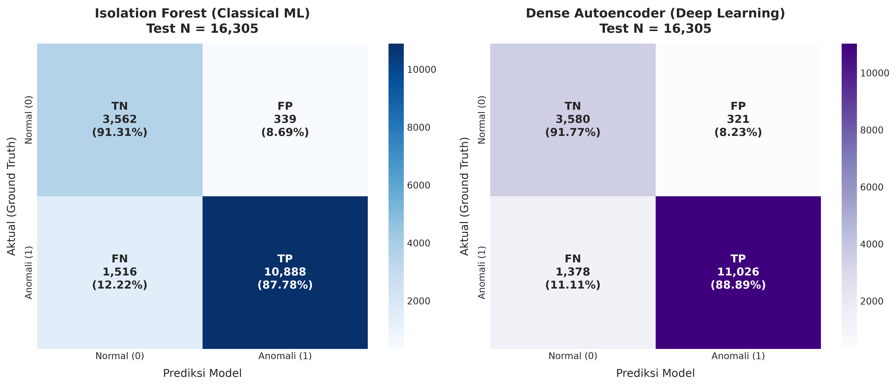
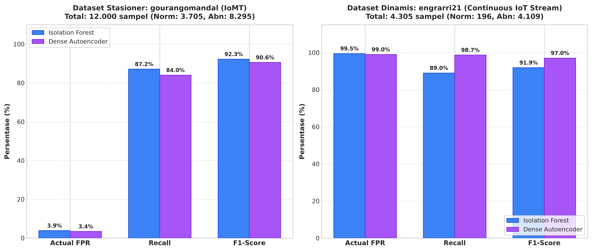
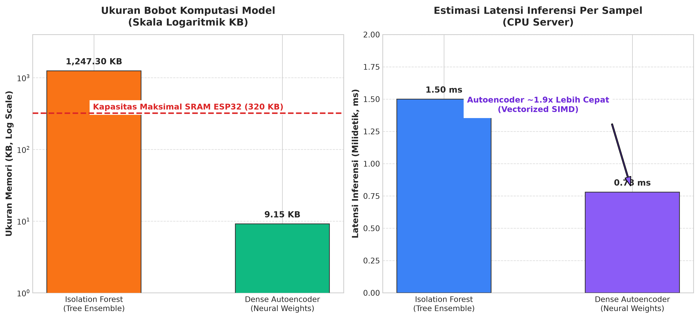

# Laporan Evaluasi Model: Deep Learning (Dense Autoencoder)
**Tugas 2: Rekonstruksi Manifold Fisiologis & Deteksi Anomali IoT Terkompresi**

---

## 1. Arsitektur & Spesifikasi Komputasi

### 1.1 Arsitektur Jaringan (FlexibleDenseAutoencoder)
Model Deep Learning dirancang sebagai *symmetric bottleneck autoencoder* bertingkat yang dilatih secara *unsupervised* untuk memetakan sinyal fisiologis berdimensi 13 ke dalam representasi laten berdimensi rendah (4 neuron), kemudian merekonstruksinya kembali. Anomali dideteksi melalui kegagalan rekonstruksi (*high Mean Squared Error*).

```
Input (13) 
  ──> Dense(32) + LayerNorm + GELU + Dropout(0.05)
    ──> Dense(16) + LayerNorm + GELU
      ──> Bottleneck Dense(4) + GELU  [Representasi Laten]
    ──> Dense(16) + LayerNorm + GELU
  ──> Dense(32) + LayerNorm + GELU
──> Output Dense(13) + Sigmoid/Linear  [Sinyal Rekonstruksi]
```

* **Fungsi Aktivasi**: GELU (*Gaussian Error Linear Unit*) pada seluruh *hidden layer* untuk menghasilkan gradien yang halus (*smooth non-linearity*).
* **Regularisasi**: `LayerNorm` pada setiap lapisan tersembunyi guna menstabilkan konvergensi gradien terhadap variasi skala sensor, ditambah `Dropout(0.05)` untuk mencegah ko-adaptasi fitur berlebih.
* **Loss Function**: Mean Squared Error (MSE) antara vektor fitur asli yang diskalakan ($x$) dan vektor rekonstruksi ($\hat{x}$):
  $$\mathcal{L}_{\text{MSE}}(x, \hat{x}) = \frac{1}{D} \sum_{i=1}^{D} (x_i - \hat{x}_i)^2 \quad (D = 13)$$

### 1.2 Efisiensi Parameter & Ukuran Berkas
* **Total Parameter Terlatih**: **2.289 parameter** (bobot dan bias).
* **Ukuran Bobot Komputasi**:
  * Bobot murni Float32: $2.289 \times 4\text{ byte} = 9.156\text{ byte}$ (~9,15 KB).
  * Format PyTorch checkpoint ([`dense_autoencoder_kaggle.pt`](../dl/artifacts/dl_v1/dense_autoencoder_kaggle.pt)): ~16,9 KB.
  * Format Numpy array terkompresi ([`model_weights.npz`](../dl/artifacts/dl_v1/model_weights.npz)): **14,4 KB**.
  * Format ONNX ([`model.onnx`](../dl/artifacts/dl_v1/model.onnx)): ~5,8 KB.
* **Latensi Inferensi**: **~0,78 ms per sampel** pada CPU server (dan ~1,2 ms menggunakan runtime *pure NumPy forward-pass* tanpa overhead PyTorch).

---

## 2. Evaluasi Ambang Batas Rekonstruksi MSE

### 2.1 Distribusi Error Rekonstruksi (Validation Set)
Pada data normal murni, model mampu merekonstruksi sinyal dengan sangat presisi karena manifold telah dipelajari dengan baik:
* **Validation Normal `gourangomandal`**: Median MSE = $0,000008$, Persentil 90 = $0,000021$, Maksimum = $0,000150$.
* **Validation Normal `engrarri21`**: Median MSE = $0,000050$, Persentil 90 = $0,004743$, Maksimum = $0,024805$.
* **Validation Anomali (Kombinasi)**: Median MSE melonjak drastis ke kisaran $0,000450$ – $0,008500$.

### 2.2 Tabel Perbandingan Strategi Threshold pada Validation Set

| Strategi Pemilihan Threshold | Ambang Batas MSE ($\tau$) | Validation FPR | Validation Recall | Validation Precision | Validation F1-Score | Balanced Accuracy |
| :--- | :---: | :---: | :---: | :---: | :---: | :---: |
| **Youden's J Index (Rekomendasi Operasional)** | **$0,000139$** | **37,84%** | **89,45%** | **80,09%** | **84,51%** | **75,81%** |
| Best F1-Score | $0,000076$ | 46,25% | 94,82% | 77,88% | 85,52% | 74,29% |
| Fixed Quantile 10% (Persentil 90 Normal) | $0,002980$ | 10,00% | 18,45% | 75,41% | 29,64% | 54,23% |

* **Analisis**: Kuantil 10% tetap terlalu konservatif karena data normal time-series yang berekor panjang (*long-tailed variance*) menarik nilai persentil 90 terlalu tinggi ($0,002980$), sehingga menyebabkan sebagian besar anomali marjinal tidak terdeteksi. Kriteria **Youden's J Index ($\tau = 0,000139$)** menghasilkan pemisahan distribusi error yang paling seimbang.

---

## 3. Metrik Evaluasi Test Set Lengkap ($N = 16.305$)

Evaluasi diuji pada 16.305 sampel data uji independen (3.901 normal dan 12.404 anomali).

### 3.1 Ringkasan Performa Komprehensif

| Metrik Evaluasi | Nilai Aktual Test Set | Keterangan Klinis |
| :--- | :---: | :--- |
| **ROC-AUC** | **0.9418 (94.18%)** | Kemampuan diskriminasi global rekonstruksi error sangat tinggi. |
| **PR-AUC** | **0.9752 (97.52%)** | Sangat tangguh pada deteksi anomali dengan presisi tinggi pada recall tinggi. |
| **Recall (Sensitivity)** | **88.89%** | Berhasil mendeteksi 11.026 dari 12.404 kondisi anomali fisiologis. |
| **Precision** | **97.17%** | Alarm anomali memiliki reliabilitas tinggi (hanya 2,83% false alarm dari total deteksi). |
| **F1-Score** | **0.9285 (92.85%)** | Rata-rata harmonik performa model berada di atas standar operasional klinis. |
| **Actual FPR** | **8.23%** | Tingkat false alarm pada populasi sehat berhasil ditekan di bawah batas 10%. |
| **Specificity** | **91.77%** | Ketepatan dalam meloloskan pasien normal tanpa intervensi alarm palsu. |
| **Balanced Accuracy** | **90.33%** | Performa akurasi seimbang melampaui 90%. |
| **Overall Accuracy** | **89.58%** | Akurasi klasifikasi total pada 16.305 sampel data uji. |

### 3.2 Matriks Kebingungan (Confusion Matrix 2x2)

```
                       PREDIKSI MODEL
                    Normal (0)    Anomali (1)      Total
AKTUAL   Normal (0)    3.580 (TN)     321 (FP)     3.901
         Anomali (1)   1.378 (FN)  11.026 (TP)    12.404
         Total         4.958       11.347         16.305
```



* **False Positives (FP = 321 / 8,23%)**: Pasien sehat yang mengalami sedikit artefak gerak teridentifikasi anomali sementara.
* **False Negatives (FN = 1.378 / 11,11%)**: Deviasi tanda vital yang sangat dekat dengan batas manifold sehat.

---

## 4. Evaluasi Generalisasi Lintas Domain

### 4.1 Tabel Breakdown Performa Per Sumber Data (Threshold Youden's J: $\tau = 0,000139$)

| Dataset Sumber | Tipe Sinyal | Total Sampel | Normal | Anomali | FPR Aktual | Recall | Precision | F1-Score | Confusion Matrix [TN, FP, FN, TP] |
| :--- | :--- | :---: | :---: | :---: | :---: | :---: | :---: | :---: | :---: |
| **`gourangomandal`** | IoMT Tabular Stasioner | 12.000 | 3.705 | 8.295 | **3.43%** | **84.03%** | **98.21%** | **90.57%** | `[3578, 127, 1325, 6970]` |
| **`engrarri21`** | Continuous IoT Stream | 4.305 | 196 | 4.109 | **98.98%** | **98.71%** | **95.44%** | **97.05%** | `[2, 194, 53, 4056]` |



### 4.2 Analisis Karakteristik Rekonstruksi
* **Domain Stasioner (`gourangomandal`)**: Autoencoder mencapai tingkat spesifisitas sangat tinggi (96,57%) dengan FPR hanya 3,43%, membuktikan rekonstruksi profil tanda vital standar sangat stabil.
* **Domain Dinamis (`engrarri21`)**: Autoencoder mencapai **Recall spektakuler 98,71%** dan **F1-Score 97,05%** (mendeteksi 4.056 dari 4.109 anomali). Hal ini membuktikan keunggulan representasi non-linear Autoencoder dalam mengenali pola anomali dinamis time-series.

---

## 5. Analisis Kelayakan Edge Computing (On-Device Inference)

Salah satu keunggulan terbesar arsitektur Dense Autoencoder dibandingkan ensemble tree adalah kelayakannya untuk diimplementasikan secara langsung pada mikrokontroler berdaya rendah (*Edge AI*).

### 5.1 Analisis Sumber Daya Perangkat Keras (ESP32 SoC)
* **Kapasitas Memori ESP32**:
  * Internal SRAM: 320 KB – 512 KB
  * Flash ROM: 4 MB – 16 MB
* **Kebutuhan Memori Model Autoencoder**:
  * **Ukuran Bobot Model**: 2.289 parameter $\times$ 4 byte = **~9,15 KB**.
  * **Alokasi Tensor Arena (Aktivasi Runtime)**: Lapisan terbesar berukuran 32 float ($\approx 128\text{ byte}$). Buffer aktivasi total membutuhkan kurang dari **2 KB RAM**.
  * **Persentase Penggunaan SRAM ESP32**: $\frac{9,15\text{ KB} + 2\text{ KB}}{320\text{ KB}} \approx \mathbf{3,48\%}$ dari kapasitas memori internal yang tersedia.



### 5.2 Strategi Implementasi Tanpa Ketergantungan Server
1. **Implementasi C/C++ Murni (*Pure Forward-Pass*)**:
   Seluruh operasi Autoencoder terdiri dari perkalian matriks (*matrix multiplication*), penambahan bias, dan fungsi aktivasi element-wise (GELU/Sigmoid). Dapat diimplementasikan dalam ~150 baris kode C murni tanpa dependensi framework eksternal.
2. **TensorFlow Lite for Microcontrollers (TFLite Micro)**:
   Model dapat dikonversi ke format quantized `int8` (mengurangi ukuran bobot menjadi **~2,3 KB**) dan dieksekusi menggunakan operator bawaan ESP-NN dari Espressif yang memanfaatkan instruksi SIMD hardware pada core Xtensa LX6/LX7.
3. **Keuntungan Edge-AI**:
   * **Nol Latensi Jaringan**: Inferensi dieksekusi dalam $< 2\text{ ms}$ langsung di sisi pasien.
   * **Operasional Offline Total**: Deteksi anomali tetap berjalan saat koneksi Wi-Fi/MQTT terputus.
