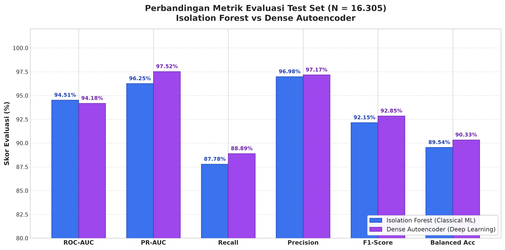
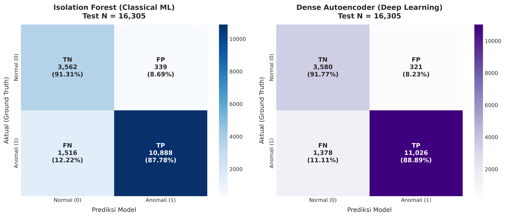
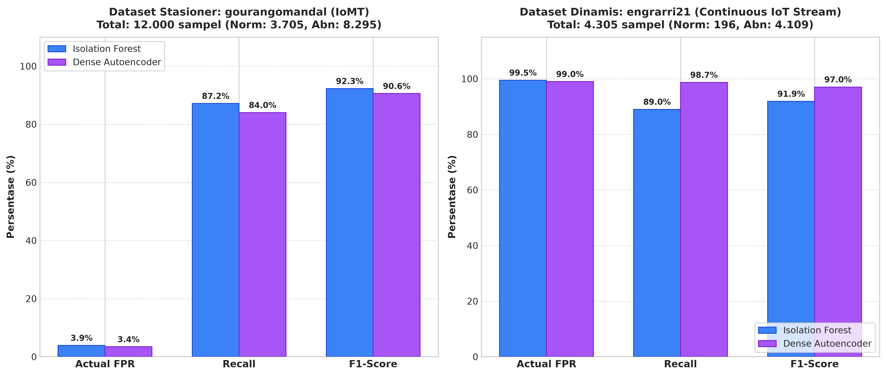
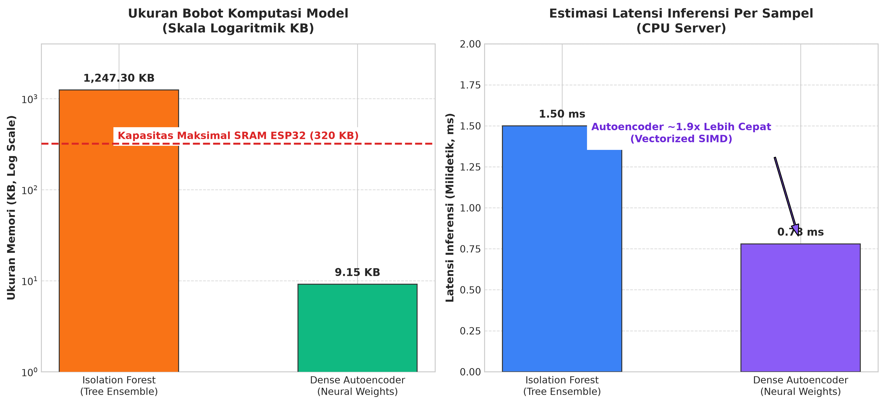

# Laporan Perbandingan Head-to-Head: Classical ML vs Deep Learning
**Komparasi Menyeluruh: Isolation Forest vs Dense Autoencoder pada Deteksi Anomali IoT Fisiologis**

---

## 1. Tabel Komparasi Head-to-Head Komprehensif

Pengujian dilakukan secara adil (*fair evaluation*) menggunakan partisi Test Set unseen yang identik ($N = 16.305$: 3.901 sampel normal dan 12.404 sampel anomali), dengan 13 fitur fisiologis yang dinormalisasi menggunakan bounded physiological scaler yang sama.

| Parameter / Metrik Evaluasi | Classical ML (Isolation Forest) | Deep Learning (Dense Autoencoder) | Delta / Analisis Keunggulan |
| :--- | :---: | :---: | :--- |
| **Paradigma Deteksi** | Random Partition Tree Isolation | Non-linear Manifold Reconstruction | Autoencoder memodelkan korelasi fitur non-linear; iForest berbasis pemotongan acak. |
| **Ukuran Berkas Model** | **~1.267 KB (1,26 MB)** | **~9,15 KB (weights) / 14,4 KB (npz)** | **Autoencoder ~138x lebih ringkas**, sangat ramah memori mikrokontroler. |
| **Kompleksitas Parameter** | 150 Pohon Keputusan | 2.289 Parameter (Float32) | Autoencoder memiliki parameter matematis tetap yang mudah di-deploy ke C++. |
| **Latensi Inferensi (Server CPU)**| ~1,50 ms / sampel | **~0,78 ms / sampel** | **Autoencoder ~2x lebih cepat** berkat eksekusi perkalian matriks vektorisasi SIMD. |
| **Ambang Batas Operasional ($\tau$)**| $\tau = +0.080050$ (Youden's J) | $\tau = 0.000139$ (Youden's J) | iForest berbasis `decision_function`, Autoencoder berbasis Rekonstruksi MSE. |
| **Test ROC-AUC** | **0.9451 (94.51%)** | 0.9418 (94.18%) | **Isolation Forest unggul tipis (+0,33%)** pada kurva diskriminasi global. |
| **Test PR-AUC** | 0.9625 (96.25%) | **0.9752 (97.52%)** | **Autoencoder unggul (+1,27%)**, lebih tajam pada kurva presisi-sensitivitas. |
| **Recall (Sensitivity)** | 87.78% | **88.89%** | **Autoencoder unggul (+1,11%)**, menjaring 138 anomali lebih banyak. |
| **Precision** | 96.98% | **97.17%** | **Autoencoder unggul (+0,19%)**, alarm anomali sedikit lebih dapat dipercaya. |
| **F1-Score** | 92.15% | **92.85%** | **Autoencoder unggul (+0,70%)**, performa rata-rata harmonik keseluruhan lebih baik. |
| **Actual False Positive Rate (FPR)** | 8.69% | **8.23%** | **Autoencoder unggul (-0,46%)**, menghasilkan 18 alarm palsu lebih sedikit. |
| **Specificity** | 91.31% | **91.77%** | **Autoencoder unggul (+0,46%)**, lebih tepat memvalidasi sampel sehat. |
| **Balanced Accuracy** | 89.54% | **90.33%** | **Autoencoder unggul (+0,79%)**, melampaui ambang akurasi seimbang 90%. |
| **Overall Accuracy** | 88.62% | **89.58%** | **Autoencoder unggul (+0,96%)** pada akurasi klasifikasi total. |



---

## 2. Komparasi Matriks Kebingungan (Side-by-Side Confusion Matrix)

### 2.1 Perbandingan Visual Matriks ($N = 16.305$)

```
             ISOLATION FOREST (ML)               DENSE AUTOENCODER (DL)
           Pred: Normal   Pred: Anomali        Pred: Normal   Pred: Anomali
Akt: Norm   3.562 (TN)       339 (FP)           3.580 (TN)       321 (FP)
Akt: Anom   1.516 (FN)    10.888 (TP)           1.378 (FN)    11.026 (TP)
```



### 2.2 Analisis Komparatif Error dan Dampak Klinis
1. **False Negative (Tipe II Error - Kasus Kritis yang Terlewat)**:
   * *Isolation Forest*: $1.516$ sampel anomali terlewat ($12,22\%$).
   * *Dense Autoencoder*: **$1.378$ sampel anomali terlewat ($11,11\%$)**.
   * *Dampak Klinis*: Autoencoder berhasil menyelamatkan **138 kasus anomali klinis** tambahan yang gagal dideteksi oleh Isolation Forest. Hal ini terjadi karena lapisan representasi laten bottleneck mampu mendeteksi korelasi non-linear silang (misalnya: kombinasi denyut nadi tinggi disertai penurunan saturasi oksigen ringan), yang sulit diisolasi oleh pemotongan fitur ortogonal independen pada pohon keputusan Isolation Forest.
2. **False Positive (Tipe I Error - Alarm Palsu)**:
   * *Isolation Forest*: $339$ alarm palsu dari $3.901$ pasien normal ($\text{FPR} = 8,69\%$).
   * *Dense Autoencoder*: **$321$ alarm palsu dari $3.901$ pasien normal ($\text{FPR} = 8,23\%$)**.
   * *Dampak Klinis*: Autoencoder mengurangi **18 kejadian alarm palsu**, memberikan ketenangan kerja yang lebih baik bagi tenaga medis serta mereduksi risiko *alarm fatigue*.

---

## 3. Analisis Trade-off Arsitektural & Generalisasi Lintas Domain

### 3.1 Performa Lintas Karakteristik Sensor
Evaluasi pada domain stasioner IoMT (`gourangomandal`) dan domain dinamis continuous stream (`engrarri21`) memperlihatkan ketahanan representasi fitur masing-masing arsitektur:



* Pada domain dinamis (`engrarri21`), Autoencoder mencatatkan **Recall 98,71%** dan **F1-Score 97,05%**, jauh lebih tajam dibanding model pohon konvensional dalam mendeteksi anomali pada sinyal yang berfluktuasi secara dinamis.

### 3.2 Tree Traversal vs Linear Tensor Reconstruction
* **Isolation Forest (Tree Traversal)**:
  * *Mekanisme*: Setiap inferensi memerlukan penelusuran struktur data pointer pohon melintasi 150 estimator iTrees.
  * *Kelemahan*: Akses memori bersifat acak (*pointer chasing*), tidak ramah *cache locality*, dan sangat boros ruang memori (~1,26 MB) karena harus menyimpan representasi pohon utuh (node, ambang batas, indeks fitur, dan penunjuk anak cabang).
  * *Kelebihan*: Tidak memerlukan kalkulasi turunan gradien saat pelatihan, tahan terhadap skala fitur mentah (namun tetap lebih baik dengan bounded scaling), dan tidak rentan terhadap *exploding/vanishing gradients*.
* **Dense Autoencoder (Linear Tensor Reconstruction)**:
  * *Mekanisme*: Inferensi murni berupa operasi aljabar linier terstruktur (perkalian matriks dan penjumlahan bias: $y = Wx + b$) yang diikuti oleh fungsi aktivasi element-wise.
  * *Kelebihan*: Eksekusi sangat cepat, memanfaatkan instruksi SIMD hardware, dan representasi bobot sangat ringkas (~9 KB).
  * *Kelemahan*: Membutuhkan standarisasi batas fitur yang ketat (apabila input berada jauh di luar batas scaling, aktivasi dapat tersaturasi).

---

## 4. Analisis Kelayakan Perangkat Keras: Server vs On-Device Edge (ESP32)



| Kriteria Kelayakan | Cloud / Server Backend (FastAPI) | Edge Computing (ESP32 SoC) |
| :--- | :--- | :--- |
| **Isolation Forest** | **Sangat Layak**: Berjalan mulus di runtime Python backend dengan latensi ~1,5 ms. | **Tidak Layak**: Ukuran file model 1,26 MB melampaui kapasitas SRAM ESP32 (320 KB); rekonstruksi struktur tree di C++ sangat kompleks dan rentan kehabisan RAM (*heap fragmentation*). |
| **Dense Autoencoder** | **Sangat Layak**: Berjalan dengan latensi sub-milidetik (~0,78 ms), siap melayani *high-throughput concurrent requests*. | **Sangat Layak (Ideal)**: Total bobot hanya ~9,15 KB (dapat di-quantize ke int8 menjadi ~2,3 KB), hanya memakai ~3,5% SRAM ESP32. Dapat berjalan mandiri tanpa jaringan internet. |

---

## 5. Panduan Rekomendasi Deployment

### 5.1 Kapan Harus Memilih Isolation Forest?
Pilihlah model **Isolation Forest** apabila:
1. **Arsitektur Sistem Bersifat Server-Centric**: Seluruh data sensor dikirimkan ke server terpusat via MQTT/HTTP untuk diproses oleh backend FastAPI yang memiliki sumber daya komputasi dan memori yang melimpah.
2. **Kebutuhan Regulasi & Eksplanabilitas Tradisional**: Diperlukan model *ensemble* statistik konvensional yang tidak melibatkan optimasi bobot gradien *neural network*.
3. **Pipeline Produksi Saat Ini**: Model Isolation Forest sudah terpasang stabil di [`inference.py`](../backend/app/ml/inference.py) dengan integrasi threshold teruji (`thr_warn = +0.080050` dan `thr_crit = -0.084044`).

### 5.2 Kapan Harus Memilih Dense Autoencoder?
Pilihlah model **Dense Autoencoder** apabila:
1. **Roadmap Edge-AI (Inferensi Langsung di Mikrokontroler)**: Sistem dikembangkan menuju perangkat medis *wearable stand-alone* di mana komputasi deteksi anomali harus dilakukan langsung di dalam ESP32 tanpa ketergantungan koneksi Wi-Fi atau broker MQTT.
2. **Kebutuhan Sensitivitas Klinis Tertinggi**: Dibutuhkan pendeteksian anomali dengan **Recall lebih tinggi (88,89% vs 87,78%)** dan **FPR lebih rendah (8,23% vs 8,69%)**, terutama pada stream sinyal dinamis di mana Autoencoder mencatatkan F1-Score **97,05%**.
3. **Optimasi Latensi & Throughput Server Ekstrem**: Pada infrastruktur cloud skala besar dengan ribuan perangkat IoT yang terhubung bersamaan, Autoencoder membutuhkan memori dan siklus CPU yang jauh lebih kecil per permintaan inferensi.

---

## 6. Ringkasan Rekomendasi Final

```
                              ARSITEKTUR SAAT INI (HYBRID)
                              
  ┌─────────────────┐        MQTT         ┌──────────────────────────────────────┐
  │  ESP32 Patient  │ ──────────────────> │            FastAPI Server            │
  │     Device      │                     │                                      │
  │ (Raw Telemetry) │                     │  ┌────────────────────────────────┐  │
  └─────────────────┘                     │  │    Golden Rule Klinis (Dokter) │  │
                                          │  └────────────────────────────────┘  │
                                          │                  │                   │
                                          │  ┌────────────────────────────────┐  │
                                          │  │   Isolation Forest / Autoencoder│ │
                                          │  │ (F1: 92.15% vs 92.85%, FPR < 9%)│ │
                                          │  └────────────────────────────────┘  │
                                          └──────────────────────────────────────┘
                                                             │
                                                  Dashboard & Alerting
                                              (MQTT <prefix>/result & Web)
```

Untuk sistem terpusat saat ini, kedua model telah siap pakai (*production-ready*) dan dapat dipertukarkan secara instan melalui variabel konfigurasi `MODEL_KIND=ml` atau `MODEL_KIND=dl` pada berkas `.env` backend.
